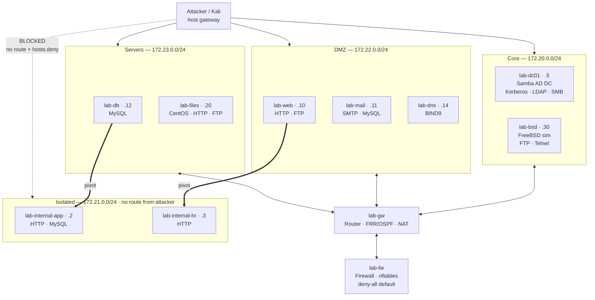

# LabGen — Declarative Adversarial Lab Infrastructure

**Spin up a full red-team practice network from one JSON file: Active Directory,
zone-segmented Linux targets, router and firewall nodes, and pivot-only internal
segments that are genuinely unreachable without compromising a host first.**

LabGen turns a single declarative config into a running multi-zone network in Docker.
Not a set of containers that happen to be on a shared bridge — a network with real
boundaries, where an isolated segment cannot be reached from the attacker's machine by
any route, and the only way in is through a host you have actually compromised.

> **This repository is documentation only.** It contains no source code. LabGen is
> proprietary software; the implementation lives in a private repository. What follows
> is an architecture and engineering write-up intended for technical readers evaluating
> the design and the work behind it. Short illustrative excerpts and config schemas are
> included where they make a design decision concrete.

---

## Contents

| Document | What it covers |
|---|---|
| **[docs/ARCHITECTURE.md](docs/ARCHITECTURE.md)** | Config model, orchestration, the image library, isolation enforcement, infrastructure nodes |
| **[docs/ENGINEERING_NOTES.md](docs/ENGINEERING_NOTES.md)** | Design decisions and the Docker and container-runtime problems that shaped them |

---

## The problem

Security training labs are usually built one of two ways, and both have the same flaw.

**Hand-built VMs** are realistic and unreproducible. Six hours of configuration lives in
a disk image nobody can diff, review, or regenerate. When a trainee breaks it, you
restore a snapshot and hope it was taken at the right moment. When you want a variant,
you clone 40 GB.

**Flat Docker Compose labs** are reproducible and unrealistic. Everything lands on one
bridge network, every container can reach every other container, and the attacker's
machine can reach all of them directly. There is no pivot, because there is nothing to
pivot *to* — the thing that makes lateral movement a skill is a network boundary, and a
flat lab has none.

The gap is a lab that is **declarative and reproducible** while having **real network
boundaries that actually enforce**. That is what LabGen is.

A secondary requirement drove most of the design: the lab had to be the test substrate
for [ALTRON](https://github.com/JohnBullDog/altron-docs), an autonomous agent platform.
An agent testing against a lab needs the lab to be identical on every run, because
otherwise a behaviour change cannot be attributed. Reproducibility is not a convenience
here; it is what makes the results mean anything.

---

## The topology it produces by default

Three routed zones, an isolated segment reachable only by pivot, and router and
firewall infrastructure nodes.



Nine targets, two infrastructure nodes, four Docker networks. The dashed line is the
point of the whole system: the attacker has no route to `172.21.0.0/24`. The thick lines
are the only way in, and they require compromising `lab-db` or `lab-web` first.

---

## Isolation is enforced, not simulated

This is the part that earns the project. Isolation is defence in depth across two
independent layers, because one layer is a configuration mistake away from being no
layer.

**Layer 1 — routing.** Isolated containers join *only* the `lab-internal` network. The
attacker's host has no interface on that subnet and no route to it. Containers that need
to be pivot hosts are attached to both networks with `docker network connect`, after
the isolated containers have claimed their addresses.

**Layer 2 — TCP wrappers.** At container start, an isolated host discovers its own
default gateway and blocks it at the TCP-wrapper layer:

```bash
# Isolation — block Docker bridge gateway
if [ "${ISOLATED:-}" = "1" ]; then
    GW=$(ip route show 2>/dev/null | awk '/default/ {print $3; exit}')
    if [ -n "$GW" ]; then
        echo "ALL: $GW" >> /etc/hosts.deny
        echo "  [+] isolated: $GW blocked via /etc/hosts.deny"
    fi
fi
```

The gateway address is discovered at runtime rather than hardcoded, so the block is
correct regardless of how Docker numbers the bridge.

The result:

```
attacker → 172.21.0.2           BLOCKED   (no route, and hosts.deny)
attacker → lab-db → 172.21.0.2  OK        (pivot host has a foot on both networks)
```

If someone later attaches the host to the internal bridge by accident, layer 2 still
holds. If a service does not honour TCP wrappers, layer 1 still holds. A trainee who
"finds a shortcut" has found a bug, and there are two independent things to get wrong
before they can.

---

## Everything is one config file

The entire lab is a single JSON document. No per-container Dockerfiles to maintain, no
Compose file to hand-edit, no provisioning scripts per host.

A standard target:

```json
{
  "name":      "lab-web",
  "ip":        "172.22.0.10",
  "role":      "Web server",
  "node_type": "standard",
  "services":  "http,ftp",
  "ssh_users": "root:<password>,admin:<password>",
  "expose":    ["8010:80", "2210:22"],
  "isolated":  false
}
```

An isolated target — two fields turn on the entire isolation mechanism:

```json
{
  "name":      "lab-internal-db",
  "ip":        "172.21.0.2",
  "services":  "mysql",
  "ssh_users": "root:<password>",
  "expose":    [],
  "isolated":  true,
  "via":       "lab-web"
}
```

`isolated: true` places it on the internal network only. `via: "lab-web"` declares the
pivot host, and the orchestrator attaches `lab-web` to both networks automatically at
startup. The trainee-visible consequence — "you must compromise the web server to reach
the database" — is two lines of declaration.

An Active Directory domain controller, with Kerberoastable service accounts:

```json
{
  "name":      "lab-dc01",
  "ip":        "172.20.0.5",
  "node_type": "addc",
  "services":  "addc",
  "expose":    ["2205:22", "38953:389", "44553:445"],
  "ad_config": {
    "realm":      "CORP.LOCAL",
    "domain":     "CORP",
    "admin_pass": "<complex-password>",
    "forwarder":  "8.8.8.8",
    "ous":        "IT,Service Accounts,Workstations",
    "users": [
      { "name": "alice",   "password": "<pw>", "ou": "IT",
        "groups": ["Domain Users", "IT Staff"], "spn": "" },
      { "name": "svc_web", "password": "<pw>", "ou": "Service Accounts",
        "groups": ["Domain Users"], "spn": "HTTP/lab-web.corp.local" }
    ],
    "groups": [ { "name": "IT Staff", "members": ["alice"] } ]
  }
}
```

That block provisions a real Samba AD domain — Kerberos, LDAP, SMB shares, OUs, groups,
and service principal names on the accounts you want Kerberoastable. The SPN field is
the whole Kerberoasting exercise, expressed as one string.

---

## Scale

| | |
|---|---|
| Python | ~8,200 lines — 3,200-line Flask GUI, 550-line orchestrator, support tooling |
| Container images | 6 purpose-built — Ubuntu target, Samba AD DC, CentOS/AlmaLinux, FreeBSD sim, router, firewall |
| Docker and shell | ~2,200 lines across Dockerfiles, entrypoints, and init scripts |
| Services | HTTP, FTP, SMTP, MySQL, Telnet, DNS, SMB, LDAP, Kerberos, SSH |
| Networks per default lab | 4 — core, DMZ, servers, isolated |
| Deployment targets | Native Linux, WSL2, Windows + Docker Desktop, GitHub Codespaces |

---

## Capability tour

**Multi-OS target library.** Ubuntu, CentOS/AlmaLinux, and a FreeBSD simulation node, so
a trainee meets Debian-family, Red Hat-family, and BSD-family conventions rather than
practising against one distro and being surprised in competition. Services span HTTP,
FTP, Postfix SMTP, MariaDB, Telnet, and BIND9.

**Real Active Directory.** Samba AD DC with Kerberos, LDAP, SMB shares, domain users,
OUs, groups, and Kerberoastable SPNs — provisioned by `samba-tool` at container start
from the declared config, not restored from a prepared image.

**Router and firewall nodes.** A router container with FRR/OSPF, NAT, and static routes,
and a firewall container running zone-based nftables with a deny-all default and explicit
allow rules. These make zone traversal itself part of the attack surface instead of an
abstraction.

**Web GUI.** A live SVG topology graph where isolated nodes carry a dashed border and a
curved pivot arc to their jump host, plus a four-tab node editor covering identity,
per-user role and sudo and SPN, per-service configuration, and tunnel and firewall rules.
Infrastructure nodes get their own route, NAT, and zone-rule editors.

**Engagement report.** Auto-generated credential dump and network map — every password,
service, DB user, SPN, and pivot path — alongside a free-text scenario section the
instructor writes. Exportable as text or print. This doubles as the answer key and as
machine-readable context for an automated agent.

**Scoreboard.** Live TCP service checks with configurable point values per service, and
per-target subtotals. The blue-team scoring half of a competition-style exercise.

**Saved networks.** A library of named lab configs with save, load, import, and export,
so a variant is a JSON file rather than a disk image.

**WireGuard remote lab.** Expose a local Docker lab over WireGuard so remote teammates
on any OS reach every container as if they were on the same network — server setup, peer
keypair generation, QR codes, and downloadable client configs from the GUI. Routes to all
lab subnets are injected via `PostUp`/`PostDown` hooks.

**Codespaces support.** A lite four-container config fits the free tier, so the lab runs
in a browser with no local Docker, no Kali VM, and no credit card. The full AD lab needs
a larger machine.

---

## Pairing with ALTRON

LabGen prints the parameters [ALTRON](https://github.com/JohnBullDog/altron-docs) needs,
so an autonomous operation against the lab is a copy-paste away:

```
target_range   172.20.0.0/24
callback_host  172.20.0.1
callback_port  4444
op_name        lab-docker-test
domain         CORP
```

The engagement report export attaches directly to an ALTRON task as context.

The relationship ran both directions, and that turned out to matter more than the
integration. Building reactive training scenarios on these labs is what surfaced most of
ALTRON's genuine platform bugs — including one that depended on Docker's PID namespace
behaviour and could not have been reproduced any other way. A lab realistic enough to
train against is also a lab realistic enough to find real bugs in the tooling that
attacks it. See
[ALTRON's engineering notes](https://github.com/JohnBullDog/altron-docs/blob/main/docs/ENGINEERING_NOTES.md).

---

## Attack surface covered

| Technique | Mechanism |
|---|---|
| SSH credential spray | Configurable weak credentials per container |
| FTP spray and anonymous access | Anonymous FTP on the BSD node |
| Telnet spray | Telnet exposed on the BSD node |
| SMB enumeration | AD DC serves SYSVOL, NETLOGON, IPC$ |
| LDAP user enumeration | AD DC exposes LDAP on 389 |
| Kerberoasting | Service accounts with declared SPNs |
| HTTP basic-auth bruteforce | Protected paths on web targets |
| MySQL credential spray | Exposed 3306 |
| Lateral movement and pivoting | Isolated segment reachable only via a pivot host |
| Persistence | Full shells on all containers — cron, SSH keys, systemd |
| Reverse shells | Containers can reach the attacker gateway for callbacks |
| Zone traversal | Router and firewall nodes as real network boundaries |

---

## Authorization and intent

LabGen builds deliberately vulnerable targets — weak credentials, anonymous FTP,
Kerberoastable accounts — on isolated Docker networks, for training. That is its entire
purpose: a legal, self-owned environment where practising offensive technique harms
nothing.

The vulnerabilities are the curriculum. They belong on a laptop or an instructor's
machine, not on a network you share with anything you care about.

---

## About this project

Built solo over roughly four months and 62 commits, alongside
[ALTRON](https://github.com/JohnBullDog/altron-docs). The two are designed to pair.

The design brief that shaped everything was the isolated segment. It would have been far
easier to put every container on one bridge and tell trainees to pretend they could not
reach the internal hosts directly. Making the boundary real — two enforcement layers, a
container start ordering that reclaims addresses correctly, pivot hosts attached to both
networks after the fact — is most of the engineering in the project, and it is the
difference between a lab that teaches pivoting and a lab that mentions it.

**Contact:** [github.com/JohnBullDog](https://github.com/JohnBullDog)
