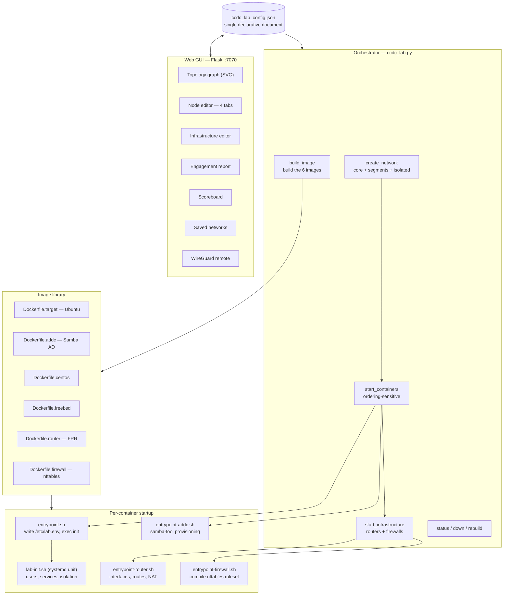

# Architecture

How a single JSON document becomes a running multi-zone network with real boundaries:
the config model, the orchestration sequence, the image library, isolation enforcement,
and infrastructure nodes.

---

## Shape of the system



Two entry points over one config. The CLI orchestrates; the GUI reads and writes the
same document. Neither owns state the other cannot see, which is why editing a lab in
the GUI and bringing it up from the CLI behave identically.

---

## The config model

One JSON document describes the whole lab:

```json
{
  "network":       "lab",
  "subnet":        "172.20.0.0/24",
  "gateway":       "172.20.0.1",
  "callback_port": "4444",
  "network_segments": [ ... ],
  "infrastructure":   [ ... ],
  "scoring":          { ... },
  "targets":          [ ... ]
}
```

### Targets

A target declares identity, placement, services, credentials, and exposure:

| Field | Purpose |
|---|---|
| `name` | Container name, also its DNS name on the Docker network |
| `ip` | Static address — placement on a subnet determines the zone |
| `node_type` | `standard` / `addc` / `centos` / `freebsd` — selects the image |
| `services` | Comma-separated list enabled at startup |
| `ssh_users` | `user:password` pairs, with role, sudo, and group metadata |
| `expose` | Host port mappings, `host:container` |
| `isolated` | Place on the internal network only |
| `via` | Pivot host that bridges to this one |
| `ad_config` | Full domain spec for `addc` nodes |

Zone membership is implied by address rather than declared separately. A target on
`172.22.0.x` is in the DMZ because that is the DMZ's subnet. One fewer field, one fewer
way for two fields to disagree.

### Per-service configuration

Each service expands into its own config block — HTTP gets virtual host, document root,
and basic-auth protected paths; FTP gets an anonymous toggle, banner, and FTP-only
accounts; SMTP gets domain, relay, and mail accounts; MySQL gets a root password, a
bind-all toggle, and DB user/password/database rows; DNS gets zone name and
master/slave/forward type.

This is what makes the labs varied without new images. "A web server with basic auth on
`/admin`" and "a web server with an open document root" are the same image and two
different config blocks.

### Users as a security model, not a list

`ssh_users` carries more than credentials. A user has a role — Admin, User, or Service
Account — a sudo toggle, extra groups, and on AD nodes an OU and SPN.

Role drives the shell: admin and user accounts get `/bin/bash`, service accounts get
`/usr/sbin/nologin`. That is a realistic detail with a direct training consequence — a
service account found during enumeration is not a free shell, which is exactly the
lesson a Kerberoastable `svc_web` account should teach.

---

## Orchestration: `up` is ordering-sensitive

Bringing the lab up is four phases, and the third one is where the real engineering is.

### Phase 1 — Images

Six images, built once and cached. The AD DC image needs `--privileged` for Samba;
router and firewall containers need it for IP forwarding and nftables.

### Phase 2 — Networks

```python
def create_network(cfg):
    # primary network
    run(f"docker network create --subnet={subnet} --gateway={gateway} {name}")

    # isolated segment — only if something actually needs it
    if any(t.get("isolated") for t in cfg.get("targets", [])):
        run(f"docker network create --subnet={INTERNAL_SUBNET} "
            f"--gateway={INTERNAL_GW} {INTERNAL_NET}")

    # extra segments for zone separation
    for seg in cfg.get("network_segments", []):
        sgw = seg.get("gateway", ssubnet.rsplit(".", 1)[0] + ".1")
        run(f"docker network create --subnet={ssubnet} --gateway={sgw} {sname}")
```

The isolated network is created only when a target actually declares `isolated: true`,
and segment gateways default to `.1` of the declared subnet rather than requiring the
field. Both are small things that keep a minimal config minimal.

### Phase 3 — Containers, in a specific order

This sequence is the heart of the system and every step of it exists because of a
failure mode.

```python
def start_containers(cfg):
    # Determine which hosts serve as pivots into the isolated segment
    pivot_hosts = set(
        t["via"] for t in cfg.get("targets", [])
        if t.get("isolated") and t.get("via")
    )

    # Disconnect pivot hosts from the internal network before starting isolated
    # containers. If a previous run failed mid-way, pivots may hold IPs that
    # isolated containers need (e.g. .2/.3), blocking their creation.
    for pivot in pivot_hosts:
        nets = run(f"docker inspect {pivot} --format '...Networks...'",
                   capture=True, check=False).stdout
        if INTERNAL_NET in nets:
            run(f"docker network disconnect {INTERNAL_NET} {pivot}", check=False)

    for t in cfg["targets"]:
        # isolated hosts go on the internal segment only
        net = INTERNAL_NET if isolated else main_net
        ...

    # Connect pivot hosts to the isolated segment so they can reach both networks
    for name in pivot_hosts:
        if INTERNAL_NET not in current_nets(name):
            run(f"docker network connect {INTERNAL_NET} {name}", check=False)
```

Read in order:

1. **Derive pivot hosts from the config.** Not a separate list — computed from which
   targets declare `isolated` with a `via`. The same principle as placement-by-address:
   do not store a thing you can derive, because stored and derived can diverge.
2. **Disconnect pivots from the internal network first.** A pivot attached from a
   previous run holds an address on `172.21.0.x` — plausibly `.2` or `.3`, exactly the
   addresses the isolated containers want. Docker refuses to start a container whose
   static IP is taken. Without this step, any run following a partial failure fails
   again, and the error message points at the wrong container.
3. **Start isolated containers on the internal network only.** They claim their
   addresses with nothing competing.
4. **Attach pivots to the internal network afterwards.** Now they get an arbitrary free
   address and can reach both sides.

The ordering is the mechanism. Reverse steps 3 and 4 and the lab comes up with the
pivot holding `.2` and the isolated host failing to start — which presents as "the lab
is broken" rather than "the addresses are contended".

### Container recreation, not restart

```python
if state == "running":
    print(f"[*] {name} already running, skipping.")
    continue
# Not running — remove and recreate. docker start on exited containers
# leaves stale network endpoints that cause "Address already in use" on
# the next start, especially on isolated networks after a daemon restart.
run(f"docker rm -f {name}", check=False)
```

`docker start` on an exited container is the obvious choice and the wrong one. Exited
containers retain network endpoints, and those endpoints hold addresses. After a Docker
daemon restart the stale endpoints survive while the containers do not, so a start
fails with "Address already in use" against an address nothing is apparently using.

Remove and recreate is slower by a second or two and always works. Running containers
are left alone, so `up` is idempotent.

### Phase 4 — Infrastructure

Router and firewall containers come up last, because they need the networks their
interfaces reference to exist. Each is wired to multiple networks: the first declared
interface is primary at creation, the rest attached afterwards.

Config is passed as packed environment strings consumed by the entrypoint:

```python
# Ifaces string: ip:subnet:zone|...
ifaces_parts.append(f"{iface.get('ip','')}:{subnet}:{zone}")
ifaces_str = "|".join(ifaces_parts)

# Rules: fromzone:tozone:proto:dport:action|...
routes = ",".join(f"{r['prefix']}:{r['via']}" for r in inf.get("routes", []))
```

Packed strings rather than mounted files is a deliberate simplification: no volume
mounts, no file-permission surprises across Linux and WSL2 and Docker Desktop, and the
full configuration of a container is visible in `docker inspect`. The cost is a parsing
layer in shell on the other side, and a schema that would not survive a value containing
`:` or `|`. For this config shape — IPs, subnets, zone names, ports, actions — that
constraint never binds.

---

## Isolation enforcement

Two independent layers, covered in the [README](../README.md#isolation-is-enforced-not-simulated).
The reasoning for two rather than one:

**Layer 1 is routing**, and routing is a property of how containers are attached. It is
strong but it is exactly one `docker network connect` away from being wrong — including
one typed by an instructor debugging something unrelated.

**Layer 2 is TCP wrappers**, applied inside the container at startup against its own
discovered gateway:

```bash
if [ "${ISOLATED:-}" = "1" ]; then
    GW=$(ip route show 2>/dev/null | awk '/default/ {print $3; exit}')
    if [ -n "$GW" ]; then
        echo "ALL: $GW" >> /etc/hosts.deny
    fi
fi
```

Discovering the gateway at runtime rather than hardcoding it means the block is correct
whatever address Docker assigns the bridge — and it keeps working if the internal
subnet is reconfigured.

Neither layer is sufficient alone. Layer 1 fails to an accidental attachment; layer 2
fails for any service that does not honour TCP wrappers. Together, a trainee reaching
the isolated segment directly requires two independent things to be wrong, and either
one failing still leaves a boundary standing.

Both the Debian-family and Red Hat-family init scripts implement this, so isolation
behaves identically on Ubuntu and CentOS targets.

---

## The image library

Six images, each existing because a different family of target behaves differently
enough to matter.

| Image | Base | Role |
|---|---|---|
| `Dockerfile.target` | Ubuntu | Standard Linux target — the workhorse |
| `Dockerfile.addc` | Debian + Samba | Active Directory domain controller |
| `Dockerfile.centos` | AlmaLinux | Red Hat-family target |
| `Dockerfile.freebsd` | — | FreeBSD simulation |
| `Dockerfile.router` | Debian + FRR | Routing, NAT, OSPF |
| `Dockerfile.firewall` | Debian + nftables | Zone-based filtering |

Targets run `systemd` as PID 1 rather than a single service process, because real
services on real targets are managed units — a trainee practising persistence needs
`systemctl` to work and needs a unit file to be a viable persistence mechanism.

The entrypoint does almost nothing: write the environment to a file, then hand off.

```bash
{
    for var in SSH_USERS SERVICES ISOLATED CALLBACK_HOST CALLBACK_PORT; do
        val="${!var}"
        [ -n "$val" ] && printf '%s=%s\n' "$var" "$val"
    done
} > /etc/lab.env

exec /sbin/init
```

Configuration then happens in `lab-init.sh`, a systemd unit that reads `/etc/lab.env`
and creates users, enables the declared services, and applies isolation. Doing it as a
unit rather than in the entrypoint means it runs with systemd already up — so services
it enables actually start, and the container's own init is the thing managing them.

### AD provisioning at startup

The AD DC provisions a real domain on first boot via `samba-tool`, from the declared
config:

```bash
samba-tool domain provision --realm="$REALM" --domain="$DOMAIN" ...

# AD_USERS format: "name|pass|ou|groups|spn,name2|pass2|ou2|groups2|spn2"
IFS='|' read -r uname upass uou ugroups uspn <<< "$entry"
samba-tool user create "$uname" "$upass" ...
samba-tool group addmembers "$grp" "$uname" 2>/dev/null || true
if [ -n "$uspn" ]; then
    samba-tool spn add "$uspn" "$uname" && echo "    [SPN] $uspn → $uname"
fi
```

Provisioning rather than shipping a pre-provisioned image costs about 60 seconds on
first boot and buys two things worth far more. The domain name, user set, OUs, groups,
and SPNs are all configurable, so an instructor can build a different domain by editing
JSON. And there is no opaque 2 GB image artifact whose contents nobody can review — the
domain is defined by text in a config file.

AD passwords must meet Samba's complexity requirements: 8+ characters with upper, lower,
digit, and symbol. A validation message beats a confusing `samba-tool` failure 60
seconds into a boot.

---

## The GUI

Flask, roughly 3,200 lines, on port 7070. A thin API over the same config file the CLI
reads.

| Route group | Purpose |
|---|---|
| `/api/state`, `/api/config` | Read and write the config document |
| `/api/lab/<cmd>`, `/api/lab/log`, `/api/lab/status/<name>` | Drive up / down / rebuild, stream output, poll per-container state |
| `/api/lab/down_one` | Stop a single container without tearing down the lab |
| `/api/score/check`, `/api/score/config` | Live TCP service checks and point values |
| `/api/networks/*` | Save, load, import, export, delete named configs |
| `/api/remote/*` | WireGuard server setup, peer generation, status, teardown |

### The topology graph

A live SVG rendering, and the visual encoding is doing real pedagogical work. Zones are
colour-banded bands. Isolated nodes carry a dashed red border and a **curved arc to
their pivot host** — so "you must go through `lab-db` to reach this" is a line on a
diagram rather than a sentence in a brief. AD DC nodes get a gold border;
infrastructure nodes render as diamonds. A status badge shows UP, PARTIAL, or OFFLINE.

Drawing the pivot relationship as a distinct curved edge rather than another network
link is the detail that makes the diagram teach. A trainee looking at it can see the
only path in.

### The node editor

Four tabs, mapping to how someone thinks about a host rather than to the config's
nesting:

- **Basic** — name, IP, role, node type, segment, isolation toggle with pivot selector
- **Users** — per-user role, sudo, extra groups, and on AD nodes SPN and OU
- **Services** — enable/disable with inline host-port mapping; each service expands its
  own config panel
- **Network** — tunnel type (SOCKS5 or port-forward) and firewall rules applied at start

### Engagement report

Two panels. The left is generated: every password, service account, DB user, SPN, and
pivot path in the lab. The right is free text for the instructor's scenario and
instructions. Exportable as text or print.

This is the answer key, and it is generated from the config rather than maintained
alongside it — so it cannot drift from the lab it describes. It also doubles as
machine-readable context for an automated agent: the same document attaches to an
ALTRON task.

### WireGuard remote lab

Expose a local lab over WireGuard so remote teammates reach every container directly.
The GUI generates server keys, writes the interface config, generates peer keypairs,
and renders QR codes plus downloadable `.conf` files. Routes to all lab subnets are
injected by `PostUp`/`PostDown` hooks, and each peer gets a `10.99.0.x` address.

It requires passwordless sudo for a narrow, explicitly enumerated command set —
`wg-quick`, `wg`, and writing exactly one config path — rather than blanket sudo. A
training tool asking for root is a training tool asking to be the weakest thing on the
machine.

---

## Deployment

| Target | Mechanism |
|---|---|
| Linux (Kali/Debian/Ubuntu) | `install.sh` → `/opt/labgen`, `labgen` and `labgen-gui` commands, desktop launcher, optional systemd unit |
| Windows | `install.ps1` → copies into WSL2, installs Flask, creates shortcut and Start Menu entry |
| GitHub Codespaces | `.devcontainer` + a lite four-container config that fits the free tier |
| Native WSL2 | Same as Linux |

The Codespaces path matters more than it looks. The full lab wants 8 GB of RAM and
Docker; the lite config — HTTP basic auth, FTP, MySQL, Telnet, and an SSH pivot to an
isolated segment — runs on a free 2-core/4 GB Codespace with port forwarding for the
GUI. Someone can try the lab in a browser with no local install and no payment method,
and the pivot exercise still works, because isolation is a property of the network
topology rather than of scale.

---

## See also

- **[ENGINEERING_NOTES.md](ENGINEERING_NOTES.md)** — the Docker and container-runtime problems behind these choices
- **[ALTRON](https://github.com/JohnBullDog/altron-docs)** — the agent platform these labs were built to test
